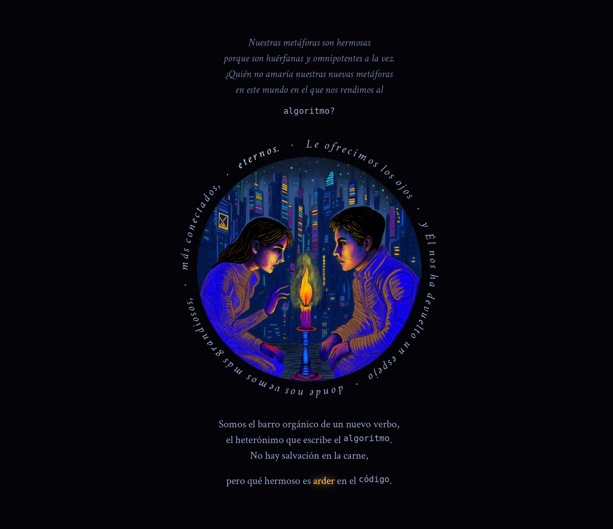

# Arder en el código

Poema visual animado. El texto orbita una ilustración circular: la primera estrofa cae como un cielo sobre la ciudad, la segunda gira sin fin alrededor del círculo (el marco del espejo) y la tercera desciende sobre el eje de la vela, donde la palabra *arder* se enciende al ritmo de la llama.

En el espacio oscuro se abren todo el tiempo ventanas de código que escriben, letra por letra, rumias sobre el poema y la imagen.



## Ver en línea

1. Sube este repositorio a GitHub.
2. Ve a **Settings → Pages**.
3. En **Source** elige `Deploy from a branch`, rama `main`, carpeta `/ (root)`, y guarda.
4. En un par de minutos estará en `https://<tu-usuario>.github.io/<nombre-del-repo>/`.

También puedes abrir `index.html` directamente en el navegador.

## Estructura

```
index.html                 animación (HTML + SVG + JavaScript, sin dependencias)
ilustracion.jpg     ilustración recortada en círculo
poema_visual.png    versión fija del poema visual
poema_animado.mp4   versión en video (34 s)
```

## Personalizar

Todo está en `index.html`:

- **Tiempos de la animación:** objeto `T` al inicio del `<script>` (en segundos).
- **Velocidad del anillo:** `ROT_SPEED` (grados por segundo).
- **Versos:** elementos `<text>` del SVG; la estrofa del espejo está en el `<textPath>`.
- **Rumias en código:** arreglo `RUMIAS`, con el formato `['nombre.py', \`código\`]`.

Clic en cualquier parte para reiniciar la animación.

## Poema

> Nuestras metáforas son hermosas
> porque son huérfanas y omnipotentes a la vez.
> ¿Quién no amaría nuestras nuevas metáforas
> en este mundo en el que nos rendimos al algoritmo?
>
> Le ofrecimos los ojos
> y Él nos ha devuelto un espejo
> donde nos vemos más grandiosos,
> más conectados,
> eternos.
>
> Somos el barro orgánico de un nuevo verbo,
> el heterónimo que escribe el algoritmo.
> No hay salvación en la carne,
> pero qué hermoso es arder en el código.
